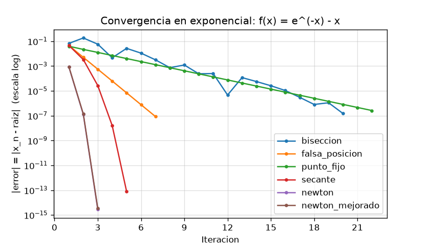
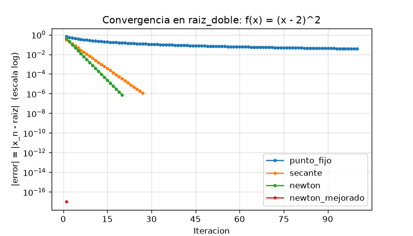

# Informe: La raíz que se esconde

Laboratorio evaluado 2 de Computación Numérica (UCM).

En este informe respondemos las preguntas de convergencia con los datos que salieron de nuestros scripts. Probamos seis métodos (bisección, falsa posición, punto fijo, secante, Newton-Raphson y Newton mejorado) en seis funciones, con tolerancia 1e-6 y un máximo de 100 iteraciones. Los datos están en `src/data/` y los gráficos en `src/assets/`.

Iteraciones que necesitó cada método con el ambiente controlado inicial (`resumen_convergencia.csv`):

| Función | Bisección | Falsa posición | Punto fijo | Secante | Newton | Newton mejorado |
|---|---|---|---|---|---|---|
| Polinómica x³ − x − 2 | 20 | 12 | 7 | 7 | 3 | 3 |
| Raíz doble (x − 2)² | no aplica | no aplica | 20 | 27 | 20 | 1 |
| Logarítmica ln(x) + x − 4 | 19 | 4 | 14 | 4 | 4 | 4 |
| Exponencial e⁻ˣ − x | 20 | 7 | 22 | 5 | 3 | 3 |
| Trigonométrica cos(x) − x | 20 | 5 | 34 | 5 | 4 | 4 |
| Mixta √x − cos(x) | 20 | 4 | 5 | 4 | 3 | 3 |

## 1. ¿Qué método convergió en menos iteraciones en cada función? ¿Por qué?

En la polinómica, la exponencial y la mixta ganaron Newton y Newton mejorado con 3 iteraciones. En la trigonométrica también ganaron ellos con 4 (la falsa posición y la secante necesitaron 5). En la logarítmica empataron en 4 la falsa posición, la secante, Newton y Newton mejorado. En la raíz doble ganó claramente Newton mejorado con una sola iteración.

Newton gana porque usa la derivada: en cada paso usa la pendiente real de la función y no solo el signo o los valores en dos puntos, y por eso cada iteración mejora mucho más la aproximación. Los métodos que no usan derivada (bisección, falsa posición y punto fijo) necesitan más pasos. La falsa posición nos sorprendió en la logarítmica y la mixta (4 iteraciones), y creemos que es porque en esos intervalos la función se parece bastante a una recta.

## 2. ¿Qué orden de convergencia tiene cada método y cómo se refleja en el gráfico |error| vs iteración?

Estimamos el orden con los errores de cada paso, usando p = ln(eₙ₊₁/eₙ) / ln(eₙ/eₙ₋₁) (script `09_orden_convergencia.py`, resultados en `orden_convergencia.csv`). También calculamos el factor promedio en que baja el error en cada iteración.

- **Bisección:** lineal. El factor promedio salió entre 0.43 y 0.58, o sea cerca de 1/2, que es lo esperado porque el intervalo se divide a la mitad. La estimación de p no es confiable acá, porque el error no baja de forma pareja (a veces el punto medio cae cerca de la raíz por casualidad), y eso se ve en los gráficos de convergencia como una línea con altibajos.
- **Falsa posición y punto fijo:** lineales, con p ≈ 1.00. En punto fijo el factor coincide con |g'(raíz)|: 0.144 en la polinómica, 0.341 en la logarítmica, 0.567 en la exponencial, 0.674 en la trigonométrica, 0.022 en la mixta y 0.5 en la raíz doble. Por eso la trigonométrica tardó 34 iteraciones y la mixta solo 5.
- **Secante:** superlineal, con p entre 1.52 y 1.91, cerca del 1.618 teórico.
- **Newton y Newton mejorado:** cuadráticos. Donde pudimos medirlo (logarítmica y trigonométrica) salió p ≈ 2.00. En las demás funciones llegan a la tolerancia en 2 o 3 pasos y no quedan suficientes puntos para estimar p.

En los gráficos `convergencia_<función>.png` (escala log) esto se ve así: los métodos lineales bajan como una recta, y mientras más chico es el factor, más empinada es la recta. La secante baja más rápido y la curva se va inclinando, y Newton cae casi en vertical en 3 o 4 puntos.

## 3. ¿Qué métodos requieren un intervalo con cambio de signo y cuáles no?

Bisección y falsa posición (los cerrados) necesitan un intervalo [a, b] con f(a)·f(b) < 0. Si no lo hay, el código dice "no aplica". Lo comprobamos en `sensibilidad_cerrados.csv`: en las cinco funciones con raíz simple probamos un intervalo sin cambio de signo (por ejemplo [2, 3] en la polinómica) y ambos métodos no aplicaron.

Punto fijo, secante, Newton y Newton mejorado (los abiertos) no necesitan cambio de signo, solo valores iniciales (x₀, y x₀ y x₁ en la secante). Eso los hace más flexibles, pero no tienen la garantía de converger.

## 4. En la función que toca el eje x (raíz doble)

- **Bisección y falsa posición no aplican**, porque f(1)·f(3) = 1 > 0 y no hay cambio de signo, aunque la raíz exista.
- **Punto fijo depende de la g que se elija.** Con g(x) = (x² + 4)/4 queda |g'(2)| = 1 y no converge en 100 iteraciones (con x₀ = 1.2 queda a 0.037 de la raíz). Si subimos el máximo a 5000, el criterio |pₙ − pₙ₋₁| < 1e-6 se cumple en 1990 iteraciones, pero el error real sigue en 0.002: el método se detiene con la raíz todavía lejos. Por eso usamos g(x) = (x + 2)/2, que sale de simplificar (x − 2)² = 0 a x − 2 = 0. Con esa g converge en 20 iteraciones, con factor 0.5 y error real de 7.6e-7 (desde x₀ = 0.5, 1.2, 1.9, 3 y 5 necesita entre 17 y 22). Esta g elimina la raíz doble por álgebra, así que no muestra la dificultad real del método con raíces múltiples. Los datos están en `sensibilidad_punto_fijo_raiz_doble.csv`.
- **Newton converge, pero lento:** 20 iteraciones con x₀ = 1.2, con p ≈ 1 y el error bajando a la mitad en cada paso (factor 0.5). Pierde el orden cuadrático porque f'(2) = 0.
- **La secante también es lineal:** 27 iteraciones, factor 0.62.
- **Newton mejorado es el mejor:** 1 iteración, desde todos los x₀ que probamos. En esta función el paso es f·f' / (f'² − f·f'') = (x − 2), así que cae exactamente en 2. En general, Newton mejorado está pensado para raíces múltiples.

(En ese gráfico el punto de Newton mejorado está en 1e-17 porque el error es exactamente 0 y la escala log no puede dibujar el 0.)

## 5. ¿Cómo influyen el intervalo y la estimación inicial?

Estos datos salen de `08_sensibilidad.py` (`sensibilidad_abiertos.csv` y `sensibilidad_cerrados.csv`). En la secante usamos x₁ = x₀ + 0.5.

**Métodos abiertos.**
- Punto fijo casi no depende de x₀: polinómica 7 a 9 iteraciones, logarítmica 14 a 16, exponencial 22 a 28, trigonométrica 34 a 35, mixta 4 a 5. Depende más de la g elegida que del punto de partida. En la raíz doble, con la g (x + 2)/2, necesita entre 17 y 22 iteraciones.
- Newton y Newton mejorado son muy rápidos si x₀ está cerca, pero sensibles si no. En la polinómica con x₀ = 1.5 Newton necesita 3 iteraciones, y con x₀ = 0.5 necesita 38: ahí f'(0.5) = −0.25 es muy chica y el primer paso salta a x = −9.
- Algunos casos no convergen porque el método se sale del dominio de la función. Newton en la mixta con x₀ = 3 salta a x = −3.33 y √x no existe; la secante en la mixta con x₀ = 3 salta a −12.97; Newton mejorado en la logarítmica con x₀ = 0.5 salta a −1.12 y ln(x) no existe; Newton mejorado en la mixta con x₀ = 0.1 salta a −0.51. En todos los casos después aparece `nan`.
- En la trigonométrica, Newton mejorado necesitó 13 iteraciones con x₀ = −2 y 4 con x₀ = 0.5.

**Métodos cerrados.**
- Bisección depende del ancho del intervalo, más o menos como log₂((b − a)/tol). En la polinómica pasó de 17 iteraciones con un intervalo de ancho 0.1 a 20 con ancho 1 y 22 con ancho 4.
- Falsa posición mejora mucho con un intervalo angosto (2 a 5 iteraciones) pero empeora con uno ancho: en la polinómica con [0, 4] necesitó 51 iteraciones (contra 12 con [1, 2]) y en la exponencial con [−2, 5] necesitó 27 (contra 7 con [0, 1]). En esos casos bisección fue más rápida.
- Con un intervalo sin cambio de signo no aplican.

## 6. ¿Qué método recomendamos según el tipo de función?

- **Funciones suaves con raíz simple y derivada fácil de calcular:** Newton (3 o 4 iteraciones con el x₀ inicial), siempre que x₀ esté cerca de la raíz y dentro del dominio.
- **Si no queremos derivar:** la secante (4 a 9 iteraciones según el valor inicial), con el mismo cuidado con el dominio.
- **Si necesitamos seguridad:** bisección, que si hay cambio de signo siempre converge y su costo no depende de la función. La falsa posición es más rápida si el intervalo es angosto, pero con intervalos anchos puede ser peor.
- **Punto fijo:** solo si encontramos una g con |g'| < 1 cerca de la raíz. Con la g elegida convergió en todas las funciones, pero lento (hasta 34 iteraciones con el x₀ inicial), y el resultado depende mucho de la g.
- **Raíz doble:** Newton mejorado.

## Análisis cuantitativo y cualitativo

**Cuantitativo (los números).** En las funciones con raíz simple, Newton y Newton mejorado necesitaron 3 o 4 iteraciones, la secante entre 4 y 7, la falsa posición entre 4 y 12, punto fijo entre 5 y 34 y bisección 19 o 20. En la raíz doble, Newton mejorado necesitó 1 iteración, Newton 20, la secante 27 y punto fijo 20 (con una g especial), y bisección y falsa posición no se pudieron aplicar.

**Cualitativo (lo que pide cada método).**
- Bisección solo necesita un intervalo con cambio de signo. No pide derivadas ni una g, y fue la más fácil de usar: la ejecutamos y listo.
- Falsa posición pide lo mismo, pero es más sensible al intervalo: en la polinómica pasó de 12 a 51 iteraciones al hacerlo más ancho.
- Punto fijo fue el más trabajoso de preparar, porque hay que despejar una g(x) distinta para cada función y comprobar que |g'| sea menor que 1. En la mixta tuvimos que usar x − 0.8·f(x) para que convergiera.
- La secante no necesita derivadas, pero sí dos valores iniciales, y puede salirse del dominio de la función.
- Newton necesita la derivada y un buen valor inicial. Newton mejorado necesita además la segunda derivada, o sea más álgebra, y también falló con algunos valores iniciales.

**El mejor.** Newton mejorado, si se pueden calcular las derivadas y se parte cerca de la raíz: convergió en 3 o 4 iteraciones en las funciones con raíz simple y fue el único que resolvió la raíz doble en un solo paso. Si no hay derivadas a mano, elegiríamos la secante, y si necesitamos que funcione con seguridad, bisección.

**El peor.** Punto fijo, porque fue el más lento (34 iteraciones en la trigonométrica) y el más difícil de armar. Además, en la raíz doble solo convergió cuando usamos una g que elimina la raíz doble con álgebra.

**El que más nos llamó la atención.** Newton mejorado en la raíz doble: pasar de 20 iteraciones (Newton) a 1 solo cambiando la fórmula nos mostró que el método importa tanto como la función. También nos llamó la atención que punto fijo con la g original "convergió" en 1990 iteraciones según el criterio de parada, aunque la raíz todavía estaba a 0.002 de distancia. Eso nos hizo ver que parar cuando la diferencia entre dos iteraciones es menor que 1e-6 no garantiza que el error real sea pequeño.

## Conclusión

Ningún método es el mejor en todo. Los que usan derivada (Newton y Newton mejorado) son los más rápidos, 3 o 4 iteraciones en las funciones con raíz simple, pero necesitan buenos valores iniciales: en nuestros datos fallaron cuando el primer paso se salió del dominio de la función. Bisección es lenta (unas 20 iteraciones) pero siempre convergió cuando hubo cambio de signo y casi no dependió de la función (19 o 20 iteraciones en todas). La secante quedó en un punto medio y la falsa posición es rápida en intervalos angostos pero se degrada en intervalos anchos. Por eso elegiríamos según el caso: Newton para funciones suaves con buen valor inicial, bisección cuando necesitamos garantía, y Newton mejorado para raíces múltiples.

En la raíz doble (x − 2)² la raíz existe, f(2) = 0, pero la función no cambia de signo: toca el eje y vuelve a subir. Por eso bisección y falsa posición no aplicaron, punto fijo solo convergió con una g que elimina la raíz doble por álgebra (con la g directa no converge), y Newton y la secante perdieron velocidad (20 y 27 iteraciones, con orden lineal). Esto muestra que "tener raíz" no es lo mismo que "cambiar de signo": el cambio de signo es una condición suficiente para asegurar una raíz (Bolzano), pero no necesaria, y los métodos cerrados dependen justo de esa condición. Newton mejorado resolvió el caso en una iteración porque corrige el problema de f'(raíz) = 0.

El punto inicial importó bastante. En la polinómica, Newton pasó de 3 iteraciones con x₀ = 1.5 a 38 con x₀ = 0.5; bisección pasó de 17 a 22 al agrandar el intervalo, y la falsa posición de 12 a 51. Además, algunos x₀ hicieron que Newton, Newton mejorado y la secante no convergieran. Punto fijo casi no cambió con x₀, pero dependió de la g elegida.